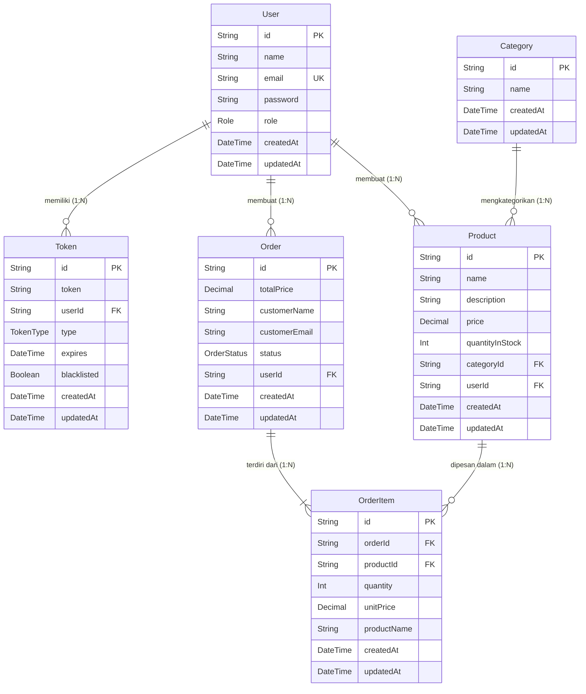

# Dokumentasi API & Skema Database - Inventory System (REST API v1)

Dokumentasi ini menyediakan gambaran komprehensif mengenai **Inventory System REST API** dan **Skema Database (Prisma ORM)**. Dokumentasi ini mencakup informasi umum arsitektur API, dokumentasi model database (ERD, relasi, tipe data), mekanisme autentikasi, format data, skema error, serta rincian lengkap tiap endpoint mulai dari input request, respons sukses, hingga respons error.

---

## 📋 Deskripsi Dokumentasi API

### 1. Informasi Umum
* **Nama Project**: Inventory System API
* **Base URL**: `http://localhost:3000/v1`
* **Format Data**: JSON (`Content-Type: application/json`)
* **Arsitektur**: RESTful API
* **Teknologi**: Node.js, Express.js, Prisma ORM, PostgreSQL, Zod Validator, Passport JWT.

---

### 2. Autentikasi & Otorisasi
Sistem ini menggunakan **JWT (JSON Web Token)** untuk mengamankan endpoint yang membutuhkan otentikasi.

* **Header Autentikasi**:
  ```http
  Authorization: Bearer <access_token>
  ```
* **Role Pengguna**:
  * `ADMIN`: Memiliki akses penuh ke seluruh endpoint (Auth, User Management, Category, Product, Order).
  * `USER`: Memiliki akses terbatas untuk mengelola Category dan Product.

---

### 3. Konvensi Status Code HTTP
| Status Code | Deskripsi | Skenario |
| :--- | :--- | :--- |
| `200 OK` | Permintaan berhasil diproses | Digunakan pada `GET`, `PATCH`, `DELETE`, dan `POST` login/refresh |
| `201 Created` | Sumber daya baru berhasil dibuat | Digunakan pada `POST` pembuatan data (Register, Category, Product, Order, User) |
| `204 No Content` | Permintaan berhasil diproses tanpa payload respons | Digunakan pada Logout (`POST /v1/auth/logout`) |
| `400 Bad Request` | Input tidak valid / error validasi / constraint gagal | Terjadi saat gagal validasi Zod, email duplikat, stok barang kurang, dll. |
| `401 Unauthorized` | Otentikasi gagal atau kredensial/token tidak valid | Terjadi saat token kedaluwarsa, tidak ada token, atau kredensial salah |
| `403 Forbidden` | Pengguna tidak memiliki hak akses (role tidak sesuai) | Terjadi saat role `USER` mencoba mengakses endpoint khusus `ADMIN` |
| `404 Not Found` | Resource yang diminta tidak ditemukan | Terjadi saat UUID item tidak ditemukan di database atau URL endpoint salah |
| `500 Internal Server Error` | Kesalahan internal pada server / database | Terjadi kesalahan yang tidak terduga pada server/database |

---

### 4. Format Respons Standar

#### A. Respons Sukses Non-Paginated
```json
{
  "status": 200,
  "message": "Pesan sukses operasi",
  "data": { ... }
}
```

#### B. Respons Sukses Paginated (Daftar Data)
Secara bawaan, endpoint list mendukung parameter `page`, `limit`, dan `sortBy`.
```json
{
  "status": 200,
  "message": "Get resources success",
  "data": {
    "results": [ ... ],
    "page": 1,
    "limit": 10,
    "totalPages": 1,
    "totalResults": 1
  }
}
```

#### C. Respons Error Standar
```json
{
  "code": 400,
  "message": "Pesan rinci mengenai error yang terjadi",
  "stack": "Error: ... (hanya ditampilkan pada environment development)"
}
```

---

## 🗄️ Dokumentasi Model Database (Prisma Schema)

Secara keseluruhan, database **Inventory System** menggunakan **PostgreSQL** yang dikelola melalui **Prisma ORM**. Terdapat 5 tabel/model utama dan 3 tipe Enum.

---

### 1. Diagram Relasi Entitas (ERD - Mermaid)



---

### 2. Tipe Enum (Enumeration)

#### A. `Role`
Menentukan hak akses pengguna dalam sistem.
* `USER`: Pengguna standar (dapat mengelola kategori dan produk).
* `ADMIN`: Pengelola sistem (akses penuh ke pengguna, kategori, produk, dan pesanan).

#### B. `TokenType`
Jenis token otentikasi yang disimpan pada tabel `Token`.
* `REFRESH`: Token untuk memperbarui akses token (`refresh token`).
* `RESET_PASSWORD`: Token untuk reset kata sandi.
* `VERIFY_EMAIL`: Token untuk verifikasi email.

#### C. `OrderStatus`
Status dari transaksi pesanan.
* `PENDING`: Pesanan dalam proses/menunggu.
* `COMPLETED`: Pesanan telah selesai diproses.
* `CANCELLED`: Pesanan dibatalkan.

---

### 3. Detail Model Database

---

#### 3.1 Model `User`
Menyimpan data akun pengguna/administrator.

| Kolom | Tipe Data Prisma | Attributes / Constraints | Deskripsi |
| :--- | :--- | :--- | :--- |
| `id` | `String` | `@id`, `@default(uuid())` | Primary Key (UUID v4). |
| `name` | `String` | - | Nama lengkap pengguna. |
| `email` | `String` | `@unique` | Alamat email unik untuk otentikasi. |
| `password` | `String` | - | Hash password (Bcrypt). |
| `role` | `Role` | `@default(USER)` | Role pengguna (`USER` atau `ADMIN`). |
| `createdAt` | `DateTime` | `@default(now())` | Waktu pembuatan akun. |
| `updatedAt` | `DateTime` | `@updatedAt` | Waktu terakhir perbaruan akun. |

* **Relasi**:
  * `tokens`: One-to-Many ke model `Token`.
  * `products`: One-to-Many ke model `Product`.
  * `orders`: One-to-Many ke model `Order`.

---

#### 3.2 Model `Token`
Menyimpan data token otentikasi & otorisasi yang diterbitkan oleh server.

| Kolom | Tipe Data Prisma | Attributes / Constraints | Deskripsi |
| :--- | :--- | :--- | :--- |
| `id` | `String` | `@id`, `@default(uuid())` | Primary Key (UUID v4). |
| `token` | `String` | - | Nilai token JWT / random token string. |
| `userId` | `String` | Foreign Key (`User.id`) | ID Pengguna pemilik token. |
| `type` | `TokenType` | - | Jenis token (`REFRESH`, `RESET_PASSWORD`, `VERIFY_EMAIL`). |
| `expires` | `DateTime` | - | Waktu kedaluwarsa token. |
| `blacklisted` | `Boolean` | `@default(false)` | Status apakah token telah dicabut/diblokir. |
| `createdAt` | `DateTime` | `@default(now())` | Waktu token dibuat. |
| `updatedAt` | `DateTime` | `@updatedAt` | Waktu token diperbarui. |

* **Relasi & Kasus Hapus (`onDelete`)**:
  * `user`: Many-to-One ke model `User` (`onDelete: Cascade`). Jika data `User` dihapus, seluruh token milik user tersebut akan otomatis terhapus.

---

#### 3.3 Model `Category`
Menyimpan pengelompokan/kategori produk inventaris.

| Kolom | Tipe Data Prisma | Attributes / Constraints | Deskripsi |
| :--- | :--- | :--- | :--- |
| `id` | `String` | `@id`, `@default(uuid())` | Primary Key (UUID v4). |
| `name` | `String` | - | Nama kategori barang. |
| `createdAt` | `DateTime` | `@default(now())` | Waktu kategori dibuat. |
| `updatedAt` | `DateTime` | `@updatedAt` | Waktu kategori diperbarui. |

* **Relasi**:
  * `products`: One-to-Many ke model `Product`.

---

#### 3.4 Model `Product`
Menyimpan data produk/barang inventaris.

| Kolom | Tipe Data Prisma | Attributes / Constraints | Deskripsi |
| :--- | :--- | :--- | :--- |
| `id` | `String` | `@id`, `@default(uuid())` | Primary Key (UUID v4). |
| `name` | `String` | - | Nama barang/produk. |
| `description` | `String?` | Opsional (Nullable) | Deskripsi rinci mengenai produk. |
| `price` | `Decimal` | - | Harga barang per unit. |
| `quantityInStock` | `Int` | - | Jumlah stok barang yang tersedia. |
| `categoryId` | `String` | Foreign Key (`Category.id`) | ID Kategori tempat produk berada. |
| `userId` | `String` | Foreign Key (`User.id`) | ID Pengguna yang mendaftarkan produk. |
| `createdAt` | `DateTime` | `@default(now())` | Waktu produk ditambahkan. |
| `updatedAt` | `DateTime` | `@updatedAt` | Waktu produk diperbarui. |

* **Relasi & Kasus Hapus (`onDelete`)**:
  * `category`: Many-to-One ke model `Category` (`onDelete: Restrict`). Kategori tidak dapat dihapus jika masih ada produk yang menggunakan `categoryId` tersebut.
  * `user`: Many-to-One ke model `User` (`onDelete: Restrict`). User tidak dapat dihapus jika masih ada produk yang didaftarkan oleh pengguna tersebut.
  * `orderItems`: One-to-Many ke model `OrderItem`.

---

#### 3.5 Model `Order`
Menyimpan header data pesanan / transaksi inventaris.

| Kolom | Tipe Data Prisma | Attributes / Constraints | Deskripsi |
| :--- | :--- | :--- | :--- |
| `id` | `String` | `@id`, `@default(uuid())` | Primary Key (UUID v4). |
| `totalPrice` | `Decimal` | `@db.Decimal(12, 2)` | Total akumulasi biaya pesanan. |
| `customerName` | `String` | - | Nama pelanggan / pembeli. |
| `customerEmail` | `String?` | Opsional (Nullable) | Alamat email pelanggan. |
| `status` | `OrderStatus` | `@default(PENDING)` | Status transaksi (`PENDING`, `COMPLETED`, `CANCELLED`). |
| `userId` | `String` | Foreign Key (`User.id`) | ID Pengguna (Admin) yang memproses pesanan. |
| `createdAt` | `DateTime` | `@default(now())` | Waktu transaksi dilakukan. |
| `updatedAt` | `DateTime` | `@updatedAt` | Waktu transaksi diperbarui. |

* **Relasi & Kasus Hapus (`onDelete`)**:
  * `user`: Many-to-One ke model `User` (`onDelete: Restrict`).
  * `orderItems`: One-to-Many ke model `OrderItem`.

---

#### 3.6 Model `OrderItem`
Menyimpan rincian produk yang dibeli pada setiap pesanan (*detail order item*).

| Kolom | Tipe Data Prisma | Attributes / Constraints | Deskripsi |
| :--- | :--- | :--- | :--- |
| `id` | `String` | `@id`, `@default(uuid())` | Primary Key (UUID v4). |
| `orderId` | `String` | Foreign Key (`Order.id`) | ID Header Pesanan. |
| `productId` | `String` | Foreign Key (`Product.id`) | ID Produk yang dipesan. |
| `quantity` | `Int` | - | Jumlah kuantitas produk yang dipesan. |
| `unitPrice` | `Decimal` | `@db.Decimal(12, 2)` | Harga satuan produk pada saat pesanan dibuat. |
| `productName` | `String` | - | Snapshot nama produk saat pesanan dibuat. |
| `createdAt` | `DateTime` | `@default(now())` | Waktu item dicatat. |
| `updatedAt` | `DateTime` | `@updatedAt` | Waktu item diperbarui. |

* **Relasi & Kasus Hapus (`onDelete`)**:
  * `order`: Many-to-One ke model `Order` (`onDelete: Cascade`). Jika header `Order` dihapus, seluruh detail `OrderItem` di dalamnya otomatis ikut terhapus.
  * `product`: Many-to-One ke model `Product` (`onDelete: Restrict`). Produk tidak dapat dihapus dari sistem jika sudah terikat pada item pesanan.

---

## 🚀 Detail Endpoint API

---

### 🔑 1. Modul Autentikasi (`/v1/auth`)

#### 1.1 `POST /v1/auth/register`
Mendaftarkan pengguna baru ke dalam sistem dan mengembalikan token otentikasi.

* **Autentikasi**: Tidak Perlu (Public)
* **Request Body**:
  | Field | Tipe | Wajib | Keterangan & Validasi |
  | :--- | :--- | :--- | :--- |
  | `name` | `string` | Ya | Min. 3 karakter, Max. 100 karakter. |
  | `email` | `string` | Ya | Format email valid, unik. |
  | `password` | `string` | Ya | Min. 8 karakter, wajib mengandung minimal 1 huruf & 1 angka. |
  | `role` | `string` | Tidak | Nilai: `"USER"` atau `"ADMIN"`. Default: `"USER"`. |

* **Contoh Request Body**:
  ```json
  {
    "name": "Budi Santoso",
    "email": "budi@example.com",
    "password": "Password123",
    "role": "USER"
  }
  ```

* **Respons Sukses (`201 Created`)**:
  ```json
  {
    "status": 201,
    "message": "Register success",
    "data": {
      "userCreated": {
        "id": "c1f7a4b0-3d8e-4a61-89bc-123456789abc",
        "name": "Budi Santoso",
        "email": "budi@example.com",
        "role": "USER",
        "createdAt": "2026-07-28T12:00:00.000Z",
        "updatedAt": "2026-07-28T12:00:00.000Z"
      },
      "token": {
        "access": {
          "token": "eyJhbGciOiJIUzI1NiIsInR5cCI6IkpXVCJ9...",
          "expires": "2026-07-28T12:30:00.000Z"
        },
        "refresh": {
          "token": "eyJhbGciOiJIUzI1NiIsInR5cCI6IkpXVCJ9...",
          "expires": "2026-08-27T12:00:00.000Z"
        }
      }
    }
  }
  ```

* **Respons Error**:
  * **`400 Bad Request`** (Email Sudah Terdaftar):
    ```json
    {
      "code": 400,
      "message": "Email already taken"
    }
    ```
  * **`400 Bad Request`** (Validasi Input Gagal):
    ```json
    {
      "code": 400,
      "message": "Password must contain at least 1 letter and 1 number"
    }
    ```

---

#### 1.2 `POST /v1/auth/login`
Melakukan otentikasi pengguna menggunakan email dan kata sandi.

* **Autentikasi**: Tidak Perlu (Public)
* **Request Body**:
  | Field | Tipe | Wajib | Keterangan & Validasi |
  | :--- | :--- | :--- | :--- |
  | `email` | `string` | Ya | Format email valid. |
  | `password` | `string` | Ya | Min. 8 karakter, mengandung huruf & angka. |

* **Contoh Request Body**:
  ```json
  {
    "email": "budi@example.com",
    "password": "Password123"
  }
  ```

* **Respons Sukses (`200 OK`)**:
  ```json
  {
    "status": 200,
    "message": "Login success",
    "data": {
      "user": {
        "id": "c1f7a4b0-3d8e-4a61-89bc-123456789abc",
        "name": "Budi Santoso",
        "email": "budi@example.com",
        "role": "USER",
        "createdAt": "2026-07-28T12:00:00.000Z",
        "updatedAt": "2026-07-28T12:00:00.000Z"
      },
      "tokens": {
        "access": {
          "token": "eyJhbGciOiJIUzI1NiIsInR5cCI6IkpXVCJ9...",
          "expires": "2026-07-28T12:30:00.000Z"
        },
        "refresh": {
          "token": "eyJhbGciOiJIUzI1NiIsInR5cCI6IkpXVCJ9...",
          "expires": "2026-08-27T12:00:00.000Z"
        }
      }
    }
  }
  ```

* **Respons Error**:
  * **`401 Unauthorized`** (Kredensial Salah):
    ```json
    {
      "code": 401,
      "message": "Incorrect email or password"
    }
    ```

---

#### 1.3 `POST /v1/auth/refresh-token`
Memperbarui access token dan refresh token yang baru dengan menggunakan refresh token yang masih berlaku.

* **Autentikasi**: Tidak Perlu (Public, namun memerlukan `refreshToken` valid di body)
* **Request Body**:
  | Field | Tipe | Wajib | Keterangan |
  | :--- | :--- | :--- | :--- |
  | `refreshToken` | `string` | Ya | Refresh token valid yang dimiliki user. |

* **Contoh Request Body**:
  ```json
  {
    "refreshToken": "eyJhbGciOiJIUzI1NiIsInR5cCI6IkpXVCJ9..."
  }
  ```

* **Respons Sukses (`200 OK`)**:
  ```json
  {
    "status": 200,
    "message": "Refresh token success",
    "data": {
      "access": {
        "token": "eyJhbGciOiJIUzI1NiIsInR5cCI6IkpXVCJ9...",
        "expires": "2026-07-28T13:00:00.000Z"
      },
      "refresh": {
        "token": "eyJhbGciOiJIUzI1NiIsInR5cCI6IkpXVCJ9...",
        "expires": "2026-08-27T12:00:00.000Z"
      }
    }
  }
  ```

* **Respons Error**:
  * **`401 Unauthorized`** (Token Kedaluwarsa/Tidak Ditemukan):
    ```json
    {
      "code": 401,
      "message": "Invalid session or user not found"
    }
    ```

---

#### 1.4 `POST /v1/auth/logout`
Mencabut (*revoke*) refresh token dari sistem sehingga tidak dapat digunakan kembali.

* **Autentikasi**: Tidak Perlu (Public)
* **Request Body**:
  | Field | Tipe | Wajib | Keterangan |
  | :--- | :--- | :--- | :--- |
  | `refreshToken` | `string` | Ya | Refresh token yang ingin dicabut. |

* **Respons Sukses (`204 No Content`)**:
  *(Tidak ada body respons)*

* **Respons Error**:
  * **`404 Not Found`** (Token Tidak Ditemukan):
    ```json
    {
      "code": 404,
      "message": "Token not found"
    }
    ```

---

### 👤 2. Modul Pengguna (`/v1/users`)

*Catatan: Seluruh endpoint pada modul ini membutuhkan header `Authorization: Bearer <access_token>` dan hanya dapat diakses oleh pengguna dengan role **`ADMIN`**.*

---

#### 2.1 `GET /v1/users`
Mendapatkan daftar pengguna terpaginasi.

* **Autentikasi**: `Bearer Token`
* **Role Minimum**: `ADMIN`
* **Query Parameters**:
  | Parameter | Tipe | Default | Keterangan |
  | :--- | :--- | :--- | :--- |
  | `name` | `string` | - | Filter nama pengguna (case-insensitive partial match). |
  | `page` | `number` | `1` | Nomor halaman (positif integer). |
  | `limit` | `number` | `10` | Jumlah data per halaman (max: `100`). |
  | `sortBy` | `string` | `createdAt:desc` | Format pengurutan: `field:asc` atau `field:desc`. Contoh: `name:asc`. |

* **Respons Sukses (`200 OK`)**:
  ```json
  {
    "status": 200,
    "message": "Get users success",
    "data": {
      "results": [
        {
          "id": "c1f7a4b0-3d8e-4a61-89bc-123456789abc",
          "name": "Budi Santoso",
          "email": "budi@example.com",
          "role": "USER",
          "createdAt": "2026-07-28T12:00:00.000Z",
          "updatedAt": "2026-07-28T12:00:00.000Z"
        }
      ],
      "page": 1,
      "limit": 10,
      "totalPages": 1,
      "totalResults": 1
    }
  }
  ```

* **Respons Error**:
  * **`401 Unauthorized`**: Token tidak valid / tidak ada.
  * **`403 Forbidden`**: Role pengguna bukan `ADMIN`.

---

#### 2.2 `POST /v1/users`
Membuat pengguna baru melalui panel admin.

* **Autentikasi**: `Bearer Token`
* **Role Minimum**: `ADMIN`
* **Request Body**:
  | Field | Tipe | Wajib | Keterangan |
  | :--- | :--- | :--- | :--- |
  | `name` | `string` | Ya | Min. 3 karakter, Max. 100 karakter. |
  | `email` | `string` | Ya | Format email valid & unik. |
  | `password` | `string` | Ya | Min 8 karakter, mengandung huruf & angka. |
  | `role` | `string` | Tidak | `"USER"` atau `"ADMIN"`. |

* **Respons Sukses (`201 Created`)**:
  ```json
  {
    "status": 201,
    "message": "Create user success",
    "data": {
      "id": "f8a9b2c1-1234-4a5b-89cd-987654321def",
      "name": "Admin Baru",
      "email": "adminbaru@example.com",
      "role": "ADMIN",
      "createdAt": "2026-07-28T12:30:00.000Z",
      "updatedAt": "2026-07-28T12:30:00.000Z"
    }
  }
  ```

---

#### 2.3 `GET /v1/users/:id`
Mendapatkan detail pengguna berdasarkan ID.

* **Autentikasi**: `Bearer Token`
* **Role Minimum**: `ADMIN`
* **Path Parameters**:
  * `id` (`string`, wajib): UUID Pengguna valid.

* **Respons Sukses (`200 OK`)**:
  ```json
  {
    "status": 200,
    "message": "Get user success",
    "data": {
      "id": "c1f7a4b0-3d8e-4a61-89bc-123456789abc",
      "name": "Budi Santoso",
      "email": "budi@example.com",
      "role": "USER",
      "createdAt": "2026-07-28T12:00:00.000Z",
      "updatedAt": "2026-07-28T12:00:00.000Z"
    }
  }
  ```

* **Respons Error**:
  * **`404 Not Found`**:
    ```json
    {
      "code": 404,
      "message": "User not found"
    }
    ```

---

#### 2.4 `PATCH /v1/users/:id`
Perbarui informasi pengguna secara parsial.

* **Autentikasi**: `Bearer Token`
* **Role Minimum**: `ADMIN`
* **Path Parameters**:
  * `id` (`string`, wajib): UUID Pengguna.
* **Request Body** (Minimal 1 properti harus dikirim):
  | Field | Tipe | Wajib | Keterangan |
  | :--- | :--- | :--- | :--- |
  | `name` | `string` | Opsional | Min. 3, Max 100 karakter. |
  | `email` | `string` | Opsional | Format email valid. |
  | `password` | `string` | Opsional | Min 8 karakter, mengandung huruf & angka. |
  | `role` | `string` | Opsional | `"USER"` atau `"ADMIN"`. |

* **Respons Sukses (`200 OK`)**:
  ```json
  {
    "status": 200,
    "message": "Update user success",
    "data": {
      "id": "c1f7a4b0-3d8e-4a61-89bc-123456789abc",
      "name": "Budi Santoso Updated",
      "email": "budi@example.com",
      "role": "ADMIN",
      "createdAt": "2026-07-28T12:00:00.000Z",
      "updatedAt": "2026-07-28T12:45:00.000Z"
    }
  }
  ```

---

#### 2.5 `DELETE /v1/users/:id`
Menghapus pengguna berdasarkan ID.

* **Autentikasi**: `Bearer Token`
* **Role Minimum**: `ADMIN`
* **Path Parameters**:
  * `id` (`string`, wajib): UUID Pengguna.

* **Respons Sukses (`200 OK`)**:
  ```json
  {
    "status": 200,
    "message": "Delete user success",
    "data": null
  }
  ```

---

### 🏷️ 3. Modul Kategori (`/v1/categories`)

*Catatan: Endpoint pada modul ini dapat diakses oleh **`ADMIN`** maupun **`USER`** yang telah terautentikasi.*

---

#### 3.1 `GET /v1/categories`
Mendapatkan daftar kategori barang terpaginasi.

* **Autentikasi**: `Bearer Token` (`ADMIN`, `USER`)
* **Query Parameters**:
  * `name` (`string`, opsional): Filter nama kategori.
  * `page` (`number`, default: `1`): Halaman.
  * `limit` (`number`, default: `10`, max: `100`): Limit per halaman.
  * `sortBy` (`string`, opsional): Contoh: `name:asc`.

* **Respons Sukses (`200 OK`)**:
  ```json
  {
    "status": 200,
    "message": "Get categories success",
    "data": {
      "results": [
        {
          "id": "e4d3c2b1-5678-4a90-bcde-112233445566",
          "name": "Elektronik",
          "createdAt": "2026-07-28T10:00:00.000Z",
          "updatedAt": "2026-07-28T10:00:00.000Z"
        }
      ],
      "page": 1,
      "limit": 10,
      "totalPages": 1,
      "totalResults": 1
    }
  }
  ```

---

#### 3.2 `POST /v1/categories`
Membuat kategori barang baru.

* **Autentikasi**: `Bearer Token` (`ADMIN`, `USER`)
* **Request Body**:
  | Field | Tipe | Wajib | Keterangan |
  | :--- | :--- | :--- | :--- |
  | `name` | `string` | Ya | Min. 3 karakter. |

* **Contoh Request Body**:
  ```json
  {
    "name": "Peralatan Kantor"
  }
  ```

* **Respons Sukses (`201 Created`)**:
  ```json
  {
    "status": 201,
    "message": "Create category success",
    "data": {
      "id": "a9b8c7d6-1122-3344-5566-77889900aabb",
      "name": "Peralatan Kantor",
      "createdAt": "2026-07-28T13:00:00.000Z",
      "updatedAt": "2026-07-28T13:00:00.000Z"
    }
  }
  ```

---

#### 3.3 `GET /v1/categories/:id`
Mendapatkan detail kategori berdasarkan ID.

* **Autentikasi**: `Bearer Token` (`ADMIN`, `USER`)
* **Path Parameters**: `id` (UUID valid)

* **Respons Sukses (`200 OK`)**:
  ```json
  {
    "status": 200,
    "message": "Get category success",
    "data": {
      "id": "e4d3c2b1-5678-4a90-bcde-112233445566",
      "name": "Elektronik",
      "createdAt": "2026-07-28T10:00:00.000Z",
      "updatedAt": "2026-07-28T10:00:00.000Z"
    }
  }
  ```

---

#### 3.4 `PATCH /v1/categories/:id`
Memperbarui nama kategori.

* **Autentikasi**: `Bearer Token` (`ADMIN`, `USER`)
* **Path Parameters**: `id` (UUID valid)
* **Request Body**:
  * `name` (`string`, opsional): Min. 3 karakter.

* **Respons Sukses (`200 OK`)**:
  ```json
  {
    "status": 200,
    "message": "Update category success",
    "data": {
      "id": "e4d3c2b1-5678-4a90-bcde-112233445566",
      "name": "Elektronik & Gadget",
      "createdAt": "2026-07-28T10:00:00.000Z",
      "updatedAt": "2026-07-28T13:10:00.000Z"
    }
  }
  ```

---

#### 3.5 `DELETE /v1/categories/:id`
Menghapus kategori.

* **Autentikasi**: `Bearer Token` (`ADMIN`, `USER`)
* **Path Parameters**: `id` (UUID valid)

* **Respons Sukses (`200 OK`)**:
  ```json
  {
    "status": 200,
    "message": "Delete category success",
    "data": null
  }
  ```

* **Respons Error**:
  * **`400 Bad Request`** (Terdapat Produk Terikat / Foreign Key Restrict):
    ```json
    {
      "code": 400,
      "message": "Foreign key constraint failed: categoryId"
    }
    ```

---

### 📦 4. Modul Produk (`/v1/products`)

*Catatan: Endpoint pada modul ini dapat diakses oleh **`ADMIN`** maupun **`USER`** yang telah terautentikasi.*

---

#### 4.1 `GET /v1/products`
Mendapatkan daftar produk inventory terpaginasi.

* **Autentikasi**: `Bearer Token` (`ADMIN`, `USER`)
* **Query Parameters**:
  | Parameter | Tipe | Default | Keterangan |
  | :--- | :--- | :--- | :--- |
  | `name` | `string` | - | Filter berdasarkan nama produk. |
  | `category` | `string` | - | Filter berdasarkan nama kategori produk. |
  | `page` | `number` | `1` | Nomor halaman. |
  | `limit` | `number` | `10` | Limit per halaman (max: 100). |
  | `sortBy` | `string` | `createdAt:desc` | Pengurutan (contoh: `price:asc`). |

* **Respons Sukses (`200 OK`)**:
  ```json
  {
    "status": 200,
    "message": "Get products success",
    "data": {
      "results": [
        {
          "id": "p1a2b3c4-9988-7766-5544-33221100aabb",
          "name": "Laptop Gaming Pro",
          "description": "Laptop spec tinggi untuk keperluan inventaris kantor",
          "price": "15000000.00",
          "quantityInStock": 25,
          "categoryId": "e4d3c2b1-5678-4a90-bcde-112233445566",
          "userId": "c1f7a4b0-3d8e-4a61-89bc-123456789abc",
          "createdAt": "2026-07-28T11:00:00.000Z",
          "updatedAt": "2026-07-28T11:00:00.000Z"
        }
      ],
      "page": 1,
      "limit": 10,
      "totalPages": 1,
      "totalResults": 1
    }
  }
  ```

---

#### 4.2 `POST /v1/products`
Menambahkan produk baru ke dalam inventaris. `userId` pencipta akan diambil secara otomatis dari token JWT pengguna yang sedang *login*.

* **Autentikasi**: `Bearer Token` (`ADMIN`, `USER`)
* **Request Body**:
  | Field | Tipe | Wajib | Keterangan |
  | :--- | :--- | :--- | :--- |
  | `name` | `string` | Ya | Min 3 karakter. |
  | `description` | `string` | Opsional | Deskripsi produk. |
  | `price` | `number` | Ya | Angka positif (> 0). |
  | `quantityInStock` | `number` | Ya | Integer non-negatif (>= 0). |
  | `categoryId` | `string` | Ya | UUID Kategori yang sudah ada. |

* **Contoh Request Body**:
  ```json
  {
    "name": "Mouse Wireless Ergonomis",
    "description": "Mouse tanpa kabel dengan batrai isi ulang",
    "price": 250000,
    "quantityInStock": 50,
    "categoryId": "e4d3c2b1-5678-4a90-bcde-112233445566"
  }
  ```

* **Respons Sukses (`201 Created`)**:
  ```json
  {
    "status": 201,
    "message": "Create product success",
    "data": {
      "id": "p9876543-2100-4433-2211-009988776655",
      "name": "Mouse Wireless Ergonomis",
      "description": "Mouse tanpa kabel dengan batrai isi ulang",
      "price": 250000,
      "quantityInStock": 50,
      "categoryId": "e4d3c2b1-5678-4a90-bcde-112233445566",
      "userId": "c1f7a4b0-3d8e-4a61-89bc-123456789abc",
      "createdAt": "2026-07-28T13:30:00.000Z",
      "updatedAt": "2026-07-28T13:30:00.000Z"
    }
  }
  ```

---

#### 4.3 `GET /v1/products/:id`
Mendapatkan detail produk berdasarkan ID.

* **Autentikasi**: `Bearer Token` (`ADMIN`, `USER`)
* **Path Parameters**: `id` (UUID Produk)

* **Respons Sukses (`200 OK`)**:
  ```json
  {
    "status": 200,
    "message": "Get product success",
    "data": {
      "id": "p9876543-2100-4433-2211-009988776655",
      "name": "Mouse Wireless Ergonomis",
      "description": "Mouse tanpa kabel dengan batrai isi ulang",
      "price": "250000.00",
      "quantityInStock": 50,
      "categoryId": "e4d3c2b1-5678-4a90-bcde-112233445566",
      "userId": "c1f7a4b0-3d8e-4a61-89bc-123456789abc",
      "createdAt": "2026-07-28T13:30:00.000Z",
      "updatedAt": "2026-07-28T13:30:00.000Z"
    }
  }
  ```

---

#### 4.4 `PATCH /v1/products/:id`
Memperbarui informasi produk secara parsial.

* **Autentikasi**: `Bearer Token` (`ADMIN`, `USER`)
* **Path Parameters**: `id` (UUID Produk)
* **Request Body** (Minimal 1 properti):
  | Field | Tipe | Wajib | Keterangan |
  | :--- | :--- | :--- | :--- |
  | `name` | `string` | Opsional | Min 3 karakter. |
  | `description` | `string` | Opsional | Boleh `null`. |
  | `price` | `number` | Opsional | Angka positif (> 0). |
  | `quantityInStock` | `number` | Opsional | Integer non-negatif (>= 0). |
  | `categoryId` | `string` | Opsional | UUID Kategori valid. |

* **Respons Sukses (`200 OK`)**:
  ```json
  {
    "status": 200,
    "message": "Update product success",
    "data": {
      "id": "p9876543-2100-4433-2211-009988776655",
      "name": "Mouse Wireless Ergonomis (V2)",
      "description": "Updated description",
      "price": "275000.00",
      "quantityInStock": 45,
      "categoryId": "e4d3c2b1-5678-4a90-bcde-112233445566",
      "userId": "c1f7a4b0-3d8e-4a61-89bc-123456789abc",
      "createdAt": "2026-07-28T13:30:00.000Z",
      "updatedAt": "2026-07-28T13:40:00.000Z"
    }
  }
  ```

---

#### 4.5 `DELETE /v1/products/:id`
Menghapus produk dari sistem.

* **Autentikasi**: `Bearer Token` (`ADMIN`, `USER`)
* **Path Parameters**: `id` (UUID Produk)

* **Respons Sukses (`200 OK`)**:
  ```json
  {
    "status": 200,
    "message": "Delete product success",
    "data": null
  }
  ```

---

### 🛒 5. Modul Pesanan / Order (`/v1/orders`)

*Catatan: Seluruh endpoint pesanan memerlukan autentikasi dan otorisasi role **`ADMIN`**. Pembuatan pesanan secara otomatis memotong stok barang yang ada pada tabel `Product` secara atomic (database transaction).*

---

#### 5.1 `GET /v1/orders`
Mendapatkan daftar pesanan terpaginasi lengkap dengan item pesanannya (`orderItems`).

* **Autentikasi**: `Bearer Token`
* **Role Minimum**: `ADMIN`
* **Query Parameters**:
  * `name` (`string`, opsional): Filter berdasarkan nama customer.
  * `page` (`number`, default: `1`): Halaman.
  * `limit` (`number`, default: `10`, max: `100`): Limit.
  * `sortBy` (`string`, opsional): Pengurutan.

* **Respons Sukses (`200 OK`)**:
  ```json
  {
    "status": 200,
    "message": "Get orders success",
    "data": {
      "results": [
        {
          "id": "ord-11223344-5566-7788-9900-aabbccddeeff",
          "totalPrice": "15250000.00",
          "customerName": "PT Maju Bersama",
          "customerEmail": "procurement@majubersama.com",
          "status": "COMPLETED",
          "userId": "c1f7a4b0-3d8e-4a61-89bc-123456789abc",
          "createdAt": "2026-07-28T14:00:00.000Z",
          "updatedAt": "2026-07-28T14:00:00.000Z",
          "orderItems": [
            {
              "id": "item-1111-2222-3333-4444",
              "orderId": "ord-11223344-5566-7788-9900-aabbccddeeff",
              "productId": "p1a2b3c4-9988-7766-5544-33221100aabb",
              "productName": "Laptop Gaming Pro",
              "quantity": 1,
              "unitPrice": "15000000.00",
              "createdAt": "2026-07-28T14:00:00.000Z",
              "updatedAt": "2026-07-28T14:00:00.000Z"
            },
            {
              "id": "item-5555-6666-7777-8888",
              "orderId": "ord-11223344-5566-7788-9900-aabbccddeeff",
              "productId": "p9876543-2100-4433-2211-009988776655",
              "productName": "Mouse Wireless Ergonomis",
              "quantity": 1,
              "unitPrice": "250000.00",
              "createdAt": "2026-07-28T14:00:00.000Z",
              "updatedAt": "2026-07-28T14:00:00.000Z"
            }
          ]
        }
      ],
      "page": 1,
      "limit": 10,
      "totalPages": 1,
      "totalResults": 1
    }
  }
  ```

---

#### 5.2 `POST /v1/orders`
Membuat transaksi order baru. Stok produk akan dikurangi secara otomatis dan status default order diatur menjadi `COMPLETED`.

* **Autentikasi**: `Bearer Token`
* **Role Minimum**: `ADMIN`
* **Request Body**:
  | Field | Tipe | Wajib | Keterangan |
  | :--- | :--- | :--- | :--- |
  | `customerName` | `string` | Ya | Min 3, Max 100 karakter. |
  | `customerEmail` | `string` | Opsional | Format email valid atau string kosong `""`. |
  | `items` | `array` | Ya | Daftar item pesanan (Min 1 item, tidak boleh ada productId duplikat). |
  | `items[].productId` | `string` | Ya | UUID Produk yang valid. |
  | `items[].quantity` | `number` | Ya | Integer positif (>= 1). |

* **Contoh Request Body**:
  ```json
  {
    "customerName": "PT Maju Bersama",
    "customerEmail": "procurement@majubersama.com",
    "items": [
      {
        "productId": "p1a2b3c4-9988-7766-5544-33221100aabb",
        "quantity": 1
      },
      {
        "productId": "p9876543-2100-4433-2211-009988776655",
        "quantity": 2
      }
    ]
  }
  ```

* **Respons Sukses (`201 Created`)**:
  ```json
  {
    "status": 201,
    "message": "Create order success",
    "data": {
      "id": "ord-11223344-5566-7788-9900-aabbccddeeff",
      "totalPrice": 15500000,
      "customerName": "PT Maju Bersama",
      "customerEmail": "procurement@majubersama.com",
      "status": "COMPLETED",
      "userId": "c1f7a4b0-3d8e-4a61-89bc-123456789abc",
      "createdAt": "2026-07-28T14:00:00.000Z",
      "updatedAt": "2026-07-28T14:00:00.000Z",
      "orderItems": [
        {
          "id": "item-1111-2222-3333-4444",
          "orderId": "ord-11223344-5566-7788-9900-aabbccddeeff",
          "productId": "p1a2b3c4-9988-7766-5544-33221100aabb",
          "quantity": 1,
          "unitPrice": "15000000.00",
          "productName": "Laptop Gaming Pro"
        }
      ]
    }
  }
  ```

* **Respons Error**:
  * **`404 Not Found`** (Produk Tidak Ada):
    ```json
    {
      "code": 404,
      "message": "Product with id p1a2b3c4-xxxx-xxxx-xxxx-xxxxxxxxxxxx does not exist"
    }
    ```
  * **`400 Bad Request`** (Stok Barang Tidak Mencukupi):
    ```json
    {
      "code": 400,
      "message": "Not enough stock for \"Laptop Gaming Pro\". Only 0 remaining"
    }
    ```
  * **`400 Bad Request`** (Produk Duplikat dalam `items`):
    ```json
    {
      "code": 400,
      "message": "Duplicate product detected"
    }
    ```

---

#### 5.3 `GET /v1/orders/:id`
Mendapatkan detail pesanan berdasarkan ID.

* **Autentikasi**: `Bearer Token`
* **Role Minimum**: `ADMIN`
* **Path Parameters**: `id` (UUID Order)

* **Respons Sukses (`200 OK`)**:
  ```json
  {
    "status": 200,
    "message": "Get order success",
    "data": {
      "id": "ord-11223344-5566-7788-9900-aabbccddeeff",
      "totalPrice": "15500000.00",
      "customerName": "PT Maju Bersama",
      "customerEmail": "procurement@majubersama.com",
      "status": "COMPLETED",
      "userId": "c1f7a4b0-3d8e-4a61-89bc-123456789abc",
      "createdAt": "2026-07-28T14:00:00.000Z",
      "updatedAt": "2026-07-28T14:00:00.000Z"
    }
  }
  ```

---

#### 5.4 `PATCH /v1/orders/:id`
Memperbarui pesanan (status, customer, atau daftar item pesanan). Jika daftar `items` diperbarui, stok produk lama akan dikembalikan terlebih dahulu lalu stok produk baru dikurangi.

* **Autentikasi**: `Bearer Token`
* **Role Minimum**: `ADMIN`
* **Path Parameters**: `id` (UUID Order)
* **Request Body** (Minimal 1 properti):
  | Field | Tipe | Wajib | Keterangan |
  | :--- | :--- | :--- | :--- |
  | `customerName` | `string` | Opsional | Min 3, Max 100 karakter. |
  | `customerEmail` | `string` | Opsional | Format email valid atau `null`. |
  | `status` | `string` | Opsional | Enum: `"PENDING"`, `"COMPLETED"`, `"CANCELLED"`. |
  | `items` | `array` | Opsional | Array object `[{ productId, quantity }]`. |

* **Contoh Request Body**:
  ```json
  {
    "status": "CANCELLED"
  }
  ```

* **Respons Sukses (`200 OK`)**:
  ```json
  {
    "status": 200,
    "message": "Update order success",
    "data": {
      "id": "ord-11223344-5566-7788-9900-aabbccddeeff",
      "totalPrice": "15500000.00",
      "customerName": "PT Maju Bersama",
      "customerEmail": "procurement@majubersama.com",
      "status": "CANCELLED",
      "userId": "c1f7a4b0-3d8e-4a61-89bc-123456789abc",
      "createdAt": "2026-07-28T14:00:00.000Z",
      "updatedAt": "2026-07-28T14:15:00.000Z",
      "orderItems": [ ... ]
    }
  }
  ```

---

#### 5.5 `DELETE /v1/orders/:id`
Menghapus data pesanan.

* **Autentikasi**: `Bearer Token`
* **Role Minimum**: `ADMIN`
* **Path Parameters**: `id` (UUID Order)

* **Respons Sukses (`200 OK`)**:
  ```json
  {
    "status": 200,
    "message": "Delete order success",
    "data": null
  }
  ```

---

## 🛠️ Ringkasan Komprehensif Skema Error

Sistem ini memiliki *centralized error handler* yang secara otomatis mengubah berbagai sumber error menjadi standar JSON error. Ringkasan kemungkinan error:

| Kode HTTP | Jenis Error | Contoh Pesan Error / Penyebab |
| :--- | :--- | :--- |
| **400** | Zod Validation Error | `"Password must be at least 8 characters"` / `"Require minimum 1 product in order"` |
| **400** | Prisma Unique Constraint (P2002) | `"Duplicate field value: email"` / `"Email already taken"` |
| **400** | Out of Stock Error | `"Not enough stock for \"Product Name\". Only X remaining"` |
| **400** | Foreign Key Error (P2003/P2014) | `"Foreign key constraint failed: categoryId"` |
| **401** | JWT Authentication Error | `"Please authenticate."` / `"Invalid session or user not found"` |
| **403** | Authorization Error | `"Role USER can not access this resource"` |
| **404** | Resource Not Found (P2025) | `"Record not found"` / `"User not found"` / `"Category not found"` |
| **500** | Database Initialization / Internal Error | `"Prisma Initialization Error: Database Connection Issues"` |
